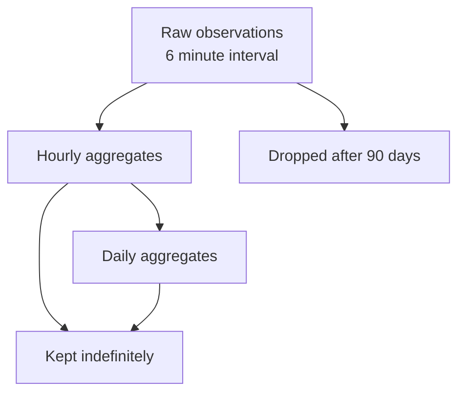

# Data Retention Policy

How long each tier of observation data is kept.

## Tiers

Raw observations are kept for ninety days. Hourly aggregates are kept indefinitely. Daily aggregates are kept indefinitely and are what the public API reads.

## Why ninety days

Ninety days covers every investigation the team has actually run, including the longest incident review. Raw data is the overwhelming majority of the storage footprint, and the aggregates preserve everything the public API needs. The storage decision is [[postgres-for-observations]].

## What this costs

A gap discovered more than ninety days late cannot be backfilled into the raw tier, because the aggregates it would have fed were already computed without it. Recomputing an aggregate over a window whose raw data was dropped is not possible. The recovery procedure is [[recover-a-data-gap]] and the terms are in [[glossary]].

